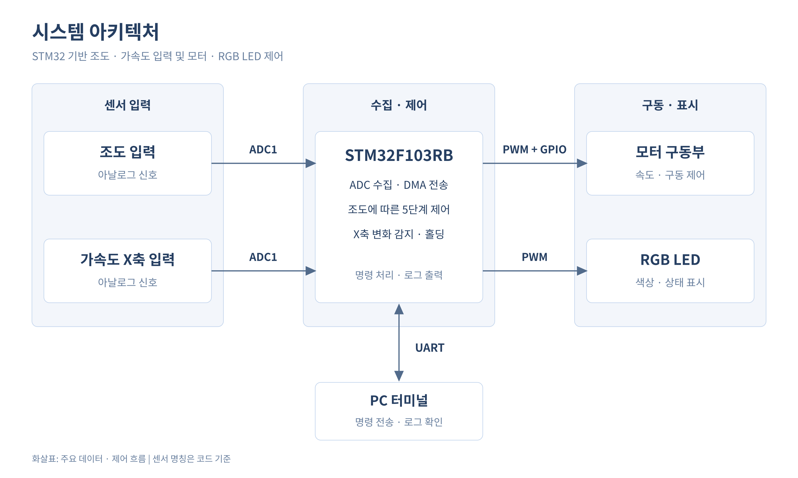

# STM32F103RB ADC DMA 기반 조도·가속도 입력 모터 및 RGB LED 제어

> **한 줄 소개** — STM32F103RB가 조도·가속도 X축으로 명명된 아날로그 입력을 ADC DMA로 수집하고, UART 명령과 입력값에 따라 모터 PWM과 RGB LED 출력을 제어하는 펌웨어입니다.

## 1. 개발 목적 및 해결하려는 문제 

| 목적 | 구현 방식 |
|---|---|
| 두 아날로그 입력을 반복 수집 | ADC1 2채널 연속 스캔과 원형 DMA 버퍼 사용 |
| 조도 입력 구간별 출력 제어 | 루프에서 읽은 10개 값의 평균을 5개 구간으로 나누어 모터 PWM과 LED 비교값 설정 |
| 외부 명령과 급격한 입력 변화에 대응 | USART2 수신 인터럽트로 명령을 수집하고 X축 입력 차이가 500 이상이면 홀딩 진입 |

위 목적은 코드 동작을 요약한 것입니다. 실제 센서 종류와 배선, 제어 효과는 제공 자료만으로 확인되지 않았습니다.

## 2. 주요 구현 기능

- **ADC1 + DMA1**: PA1의 `ADC1_IN1`, PB0의 `ADC1_IN8`을 연속 스캔하여 `ADC_value[0..1]`에 저장.
- **5단계 출력**: 조도 평균 1~4095를 820 단위 구간으로 분류해 TIM2 CH1 비교값 1000/800/600/400/200과 TIM3의 세 채널 비교값 변경. 평균이 0이면 새 구간을 선택하지 않음.
- **UART 명령**: USART2에서 바이트별 인터럽트 수신, `START` / `END` 및 홀딩 중 `PLAY` / `END` 비교.
- **홀딩**: X축 ADC 연속 읽기 차이가 500 이상이면 모터 정지 명령 후 LED 세 채널을 약 300 ms 간격으로 전환.
- **로그 출력**: `printf`를 USART2로 전달. 수신은 인터럽트 방식이지만 송신은 바이트별 블로킹 방식.

명령 수신과 홀딩 종료에 확인이 필요한 문제가 있어 안전 동작이 보장된다고 주장하지 않습니다. [트러블슈팅](docs/05_troubleshooting.md)을 참고하세요.

## 3. 시스템 아키텍처

화살표는 **코드가 취급하는 데이터·제어 방향**이며, 실제 배선이나 구동 회로의 존재를 증명하지 않습니다. DMA는 MCU 내부의 ADC→메모리 전송입니다. 핀은 아래 표와 [하드웨어 문서](docs/02_hardware.md)에 분리했습니다.

## 4. 개발 환경 및 사용 기술

| 항목 | 확인된 내용 |
|---|---|
| MCU / 보드 | STM32F103RBT6, LQFP64; `.ioc`는 `board=custom`, 구체적인 보드 모델 미확인 |
| IDE / 언어 | STM32CubeIDE 프로젝트, C |
| 패키지 / 빌드 | `.ioc`: STM32Cube FW_F1 V1.8.7; 기존 Debug makefile: GNU Tools for STM32 14.3.rel1 |
| 클럭 | HSI 8 MHz / 2 × 16 = SYSCLK 64 MHz, ADC 8 MHz |
| 실행 구조 | RTOS 없이 super-loop, ADC DMA, USART2·DMA·SysTick 인터럽트 |

## 5. 하드웨어 구성 요약

다음은 **코드상 기능과 의도된 대상**이며 실제 배선은 회로도·사진이 없어 미확인입니다.

| 신호 | MCU 핀 | 연결 대상 |
|---|---|---|
| ADC1 IN1 / IN8 | PA1 / PB0 | 코드상 조도 / 가속도 X 아날로그 입력 |
| TIM2 CH1 | PA0 | 모터 PWM 입력으로 의도 |
| `motor_control1` / `motor_control2` | PA6 / PA7 | 모터 방향·제어 입력으로 의도 |
| TIM3 CH1 / CH2 / CH3 | PC6 / PC7 / PC8 | RGB LED 세 채널로 의도 |
| USART2 TX / RX | PA2 / PA3 | PC 터미널과의 직렬 경로로 의도 |
| SWDIO / SWCLK | PA13 / PA14 | 디버그 인터페이스 설정 |

## 6. 핵심 펌웨어 구현 내용

1. **연속 샘플 전송** — [`main()`](Core/Src/main.c)에서 ADC 보정 후 `HAL_ADC_Start_DMA()`로 두 rank를 순환 버퍼에 전송합니다. 버퍼 두 값의 동시성은 별도 보장하지 않습니다.
2. **출력 구간화** — [`main()`](Core/Src/main.c)의 루프가 10회 읽은 조도값의 정수 평균으로 LED 비교값과 모터 모드를 결정합니다. 일정 시간 간격이나 서로 다른 10회의 ADC 변환은 보장하지 않습니다.
3. **명령과 홀딩** — [`HAL_UART_RxCpltCallback()`](Core/Src/main.c)이 수신을 재등록하고, `holding_function()`이 모터 출력을 낮춘 뒤 틱 차분으로 LED를 전환합니다. 홀딩은 별도 바쁜 대기 루프입니다.
4. **주변장치 연결** — [`stm32f1xx_hal_msp.c`](Core/Src/stm32f1xx_hal_msp.c)에서 ADC DMA 연결, UART IRQ 및 TIM3 full remap을 설정합니다.

처리 순서, HAL 내부와 한계는 [펌웨어 구현](docs/04_firmware_implementation.md)에 정리했습니다.

## 7. 트러블슈팅 요약

- **실제 장애 해결 이력**: 확인할 Git 저장소나 디버그 로그가 없어 기록하지 않았습니다.
- **코드상 대응**: 홀딩 진입 시 PWM 비교값과 모터 제어 핀을 0으로 설정; 재개 시 이전 모드를 초기화해 출력 갱신을 유도.
- **미해결 검토 사항**: UART 버퍼 범위·동기화, 홀딩 중 `END` 이후 모터 출력 재설정 가능성, DMA 데이터의 시점·인터럽트 부하, HAL 반환값 미검사.

상세 근거와 제안: [05_troubleshooting.md](docs/05_troubleshooting.md).

## 8. 테스트 및 결과

- 이번 작업에서 소스, 설정, HAL 호출 경로와 문서 링크를 정적으로 확인했습니다.
- 로컬에서 확인한 기존 `Debug` ELF와 map은 저장소에 포함하지 않았으며, 최신 소스와의 완전한 일치 및 당시 빌드 성공 과정은 확인되지 않았습니다. 문서 작성 당시 재빌드하지 않았습니다.
- 실기 로그, PWM 파형, 센서 기준값과 안전 정지 실측은 제공되지 않아 검증하지 못했습니다.
- 재현 가능한 검증 계획: [06_testing_and_results.md](docs/06_testing_and_results.md).

## 9. 상세 문서

| 문서 | 내용 |
|---|---|
| [01_system_architecture.md](docs/01_system_architecture.md) | 시스템 구성, 초기화와 실행 흐름 |
| [02_hardware.md](docs/02_hardware.md) | 핀 및 전기적 확인 범위 |
| [03_cubemx_configuration.md](docs/03_cubemx_configuration.md) | 주변장치 설정, 클럭과 주기 계산 |
| [04_firmware_implementation.md](docs/04_firmware_implementation.md) | 로직, 인터럽트와 HAL 호출 경로 |
| [05_troubleshooting.md](docs/05_troubleshooting.md) | 설계 대응, 미해결 문제와 추가 근거 |
| [06_testing_and_results.md](docs/06_testing_and_results.md) | 수행한 확인, 미검증 항목과 테스트 계획 |

## 10. 소스 구성

| 구분 | 파일 | 역할 |
|---|---|---|
| 사용자 구현 영역 | [main.c](Core/Src/main.c)의 `USER CODE` | 앱 로직, UART 콜백과 출력 연결 |
| CubeMX 생성 영역 | [main.c](Core/Src/main.c), [main.h](Core/Inc/main.h), [stm32f1xx_hal_msp.c](Core/Src/stm32f1xx_hal_msp.c), [stm32f1xx_it.c](Core/Src/stm32f1xx_it.c) | 주변장치 설정, 핀·IRQ 연결 |
| IDE 생성 지원 코드 | [syscalls.c](Core/Src/syscalls.c), [sysmem.c](Core/Src/sysmem.c), [startup](Core/Startup/startup_stm32f103rbtx.s), [링커 스크립트](STM32F103RBTX_FLASH.ld) | 런타임, 시작 코드, 메모리 배치 |
| 제조사 제공 라이브러리 | [Drivers/](Drivers/) | STM32 HAL 및 CMSIS |
| 설정 | [.ioc](80-8.EVB_project_dma.ioc), [.project](.project), [.cproject](.cproject) | CubeMX 및 STM32CubeIDE 프로젝트 설정. 로컬 빌드 산출물은 제외 |

구분은 파일의 템플릿 및 `USER CODE` 표시에 따른 것이며 실제 작성자를 단정하지 않습니다.
