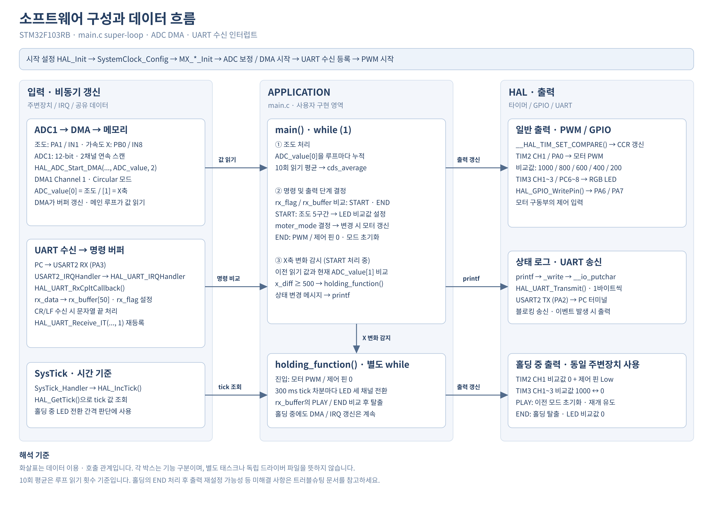
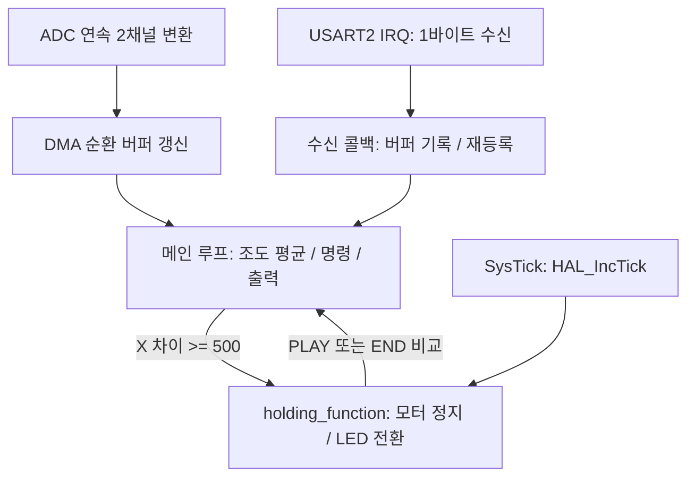

# 01. 시스템 아키텍처

> 근거: [main.c](../Core/Src/main.c), [MSP](../Core/Src/stm32f1xx_hal_msp.c), [인터럽트](../Core/Src/stm32f1xx_it.c), [.ioc](../80-8.EVB_project_dma.ioc). 외부 장치는 코드의 변수·주석상 역할이며 실물 모델과 배선은 미확인.

## 1. 구성과 데이터 흐름

그림의 화살표는 데이터 이용·호출 관계를 나타냅니다. 각 박스는 기능 구분이며, 별도 태스크나 독립 드라이버 파일을 뜻하지 않습니다.

| 모듈 | 코드상 역할 |
|---|---|
| ADC1 + DMA1 Channel 1 | 두 채널을 순서대로 변환하여 `ADC_value`를 반복 갱신 |
| 메인 루프 | 조도 10회 읽기 평균, 명령 비교, LED 비교값·모터 모드 결정 |
| USART2 | 바이트별 명령 수신과 블로킹 로그 송신 |
| TIM2 CH1 + GPIO | 모터 PWM과 제어 핀 출력 |
| TIM3 CH1~3 | LED 세 채널 PWM |
| SysTick | HAL 틱 증가, 홀딩 상태 LED 전환의 시간 기준 |

## 2. 부팅과 초기화

1. [startup](../Core/Startup/startup_stm32f103rbtx.s)의 `Reset_Handler`가 런타임을 준비하고 `main()`으로 진입합니다.
2. `HAL_Init()` → `SystemClock_Config()` → `MX_GPIO_Init()` → `MX_DMA_Init()` → `MX_USART2_UART_Init()` → `MX_TIM2_Init()` → `MX_ADC1_Init()` → `MX_TIM3_Init()`.
3. 시작 메시지 출력 → ADC 보정 → 2개 항목 DMA 시작 → UART 1바이트 인터럽트 수신 시작 → TIM3의 세 PWM과 TIM2 CH1 PWM 시작 → 모터 제어 핀 Low → 입력 안내 출력.
4. 각 HAL 시작·보정 호출의 반환값은 사용자 코드에서 검사하지 않습니다. 생성 초기화 코드의 오류는 `Error_Handler()`에서 인터럽트를 끄고 정지합니다.

## 3. 실행 관계

| 실행 경로 | 실제 동작 |
|---|---|
| 일반 루프 | 대기 시간 없이 반복하며 10회 루프 읽기를 평균. `rx_flag`가 1인 후 매 반복 현재 버퍼와 명령을 비교 |
| DMA IRQ | 절반·완료·오류 인터럽트를 HAL 핸들러에 전달. 애플리케이션의 ADC 완료 콜백 재정의는 없음 |
| UART IRQ | `HAL_UART_IRQHandler()` → 수신 완료 콜백; 콜백에서 다음 1바이트 수신 재등록 |
| SysTick | `HAL_IncTick()`으로 틱을 증가. 홀딩 LED 전환 조건의 기준 |
| 홀딩 | `holding_function()`의 별도 `while`에서 명령과 300 ms 틱 차분을 확인. 일반 루프의 평균과 X 비교는 그동안 중단되지만 DMA와 IRQ는 계속 가능 |

300 ms는 **홀딩 내부 LED 전환 간격**이지 센서 수집 주기나 전체 프로그램의 주기가 아닙니다. `printf`는 블로킹이며, 인터럽트와 실행 시간에 따라 전환 시각이 늦어질 수 있습니다.
